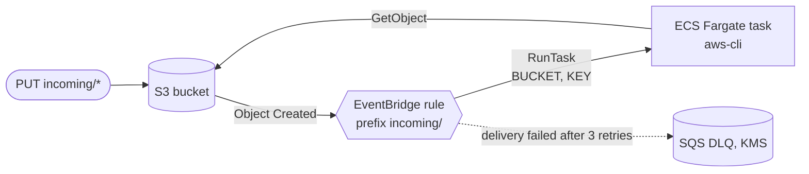

# ECS task triggered by S3

A file dropped under `incoming/` runs an ECS Fargate task through an EventBridge rule on the S3 "Object Created"
event. The bucket and the key of the file reach the container as the `BUCKET` and `KEY` environment variables.

---

## Architecture



- The job copies `s3://$BUCKET/$KEY` and **fails when the file is empty** (the business failure of the tests). It runs
  in the private subnets, through the endpoints of [base](../base/README.md).
- The bucket, the DLQ and the log groups are encrypted with the shared KMS key of [base](../base/README.md). The role
  of the rule target can only run this task definition on this cluster and pass the two task roles.

## Retry & failure handling

The retry of EventBridge covers the **launch** of the task, not what the task does:

| What fails | Retried? | Where it lands |
|---|---|---|
| EventBridge cannot run the task (`RunTask` refused: capacity, throttling, a transient error) | Yes: `maximum_retry_attempts = 3`, `maximum_event_age_in_seconds = 3600` | After the retries: the event goes to the DLQ `lab-ecs-task-s3-dlq` (kept 14 days, encrypted with the shared key) |
| The task starts and the container exits with an error (code other than 0) | **No** | Nowhere: the task stops, its exit code is in the `ECS Task State Change` event and in `describe-tasks`, its logs in CloudWatch |
| The task runs for ever | No timeout in this sample | The task runs until you stop it |

For a retry at the level of the job (the exit code), use Step Functions: see
[step-function-s3](../step-function-s3/README.md), whose state machine retries the task when it fails.

## Quick Start

The job image comes from the ECR Public pull through cache of `base`: **warm it up once before the first apply** (see
[base](../base/README.md#container-images-ecr-pull-through-cache), the aws-cli line). The job runs on ARM64 by default
(`job_cpu_architecture`, the cheapest on Fargate): pull the `linux/arm64` image, or set `X86_64` for the other platform.

```bash
# Initialize (needs TF_VAR_state_bucket in the root .env) and apply, from the repository root
task ecs-task-s3:init
task ecs-task-s3:apply
```

## Try it

```bash
BUCKET="$(terraform -chdir=samples/ecs-task-s3/infra output -raw bucket_name)"
CLUSTER="$(terraform -chdir=samples/ecs-task-s3/infra output -raw cluster_arn)"

echo 'hello' | aws s3 cp - "s3://$BUCKET/incoming/demo.txt"
aws ecs list-tasks --cluster "$CLUSTER" --desired-status STOPPED
```

## Tests

```bash
# terraform test on a throwaway Floci container (fake credentials, no AWS account)
task ecs-task-s3:test

# Smoke test on the real account of AWS_PROFILE, after `apply` (asks for confirmation, for you only)
task ecs-task-s3:e2e
```

`task ecs-task-s3:test` applies the stack on the emulator, then runs an end-to-end check (`infra/tests/e2e`): it drops a
readable and an empty file, waits for the two tasks the rule starts, checks the environment the rule passed to each and
their exit codes (0, and 1 without any retry), and reads the contract back from the emulator. The test uses the public
image on `X86_64`: Floci runs a task for the architecture it names, which would need emulation on an amd64 runner for
`ARM64`. The DLQ path is not reproducible on the emulator (it needs a `RunTask` that EventBridge cannot deliver). Floci
does not enforce IAM: the policies, including the KMS actions and the key policy statement of EventBridge in `base`,
follow the AWS documentation and are only exercised by `task ecs-task-s3:e2e`. CI runs the Terraform test on every pull
request (`build-ecs-task-s3`).

## Cost

Nothing is billed at rest by this stack: Fargate (per second of task), S3, SQS and CloudWatch Logs (one day of
retention) are billed per use. The task reaches AWS through the interface endpoints of [base](../base/README.md),
which are billed there.

## Task commands

| Command | Description |
|---|---|
| `task ecs-task-s3:init` | Initialize Terraform with the shared S3 state bucket |
| `task ecs-task-s3:plan` | Plan the changes |
| `task ecs-task-s3:apply` | Apply the changes |
| `task ecs-task-s3:destroy` | Destroy the resources |
| `task ecs-task-s3:test` | `terraform test` on Floci, e2e checks included |
| `task ecs-task-s3:e2e` | Smoke test on the real account (you only) |
| `task ecs-task-s3:docs` | Regenerate the Terraform documentation |

---

Terraform reference (inputs, outputs, resources): [`infra/TFDOCS.md`](infra/TFDOCS.md), generated by pre-commit.
