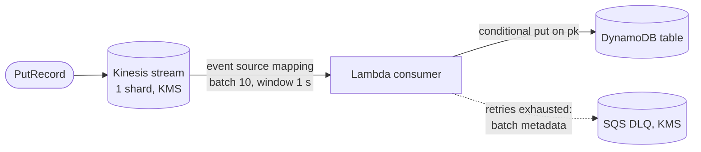

# Lambda triggered by Kinesis

Events put in a Kinesis stream are consumed by a Lambda function (Python 3.13, arm64) through an event source mapping.
Each valid JSON event is stored once in DynamoDB; an invalid record is reported in the partial batch response, retried,
then dead-lettered in SQS.

---

## Architecture



- The stream, the table, the DLQ and the log group are encrypted with the shared KMS key of [base](../base/README.md).
- The function has no VPC: it only calls DynamoDB, SQS and the stream.

## Retry & failure handling

| Mechanism | Values | Where a failure lands |
|---|---|---|
| Partial batch response | `function_response_types = ["ReportBatchItemFailures"]`: the function returns the sequence numbers of the records it could not store. Lambda retries from the first one reported | Retried (below) |
| Batch split | `bisect_batch_on_function_error = true`: a batch that fails with a function error is split in two and retried, which isolates the failing record | Retried (below) |
| Retries | `maximum_retry_attempts = 2`, `maximum_record_age_in_seconds = 3600` | After the last retry, or after one hour: the batch is dropped from the shard and its **metadata** goes to the DLQ |
| Idempotence | `PutItem` with `attribute_not_exists(pk)`: a record delivered twice (a retry of its batch) is stored once, and `ConditionalCheckFailedException` counts as a success | Nowhere |
| Invalid record | Not base64, not a JSON object, or no non-empty string `id`: reported as failed. Any other DynamoDB error is reported too | DLQ, after the retries |
| DLQ | Messages kept 14 days, encrypted with the shared key. The message is the invocation record with `KinesisBatchInfo` (shard, first and last sequence numbers, stream ARN): **not the payload**. To recover the records, read the stream by those sequence numbers within its 24 hours of retention | |

The mapping starts at `TRIM_HORIZON`: the records written before its poller starts are not lost.

## Quick Start

The sample reads the shared KMS key from the state of `base`: apply `base` first.

```bash
# Initialize (needs TF_VAR_state_bucket in the root .env) and apply, from the repository root
task lambda-kinesis:init
task lambda-kinesis:apply
```

## Try it

```bash
STREAM="$(terraform -chdir=samples/lambda-kinesis/infra output -raw stream_name)"
TABLE="$(terraform -chdir=samples/lambda-kinesis/infra output -raw table_name)"
DLQ="$(terraform -chdir=samples/lambda-kinesis/infra output -raw dlq_url)"

# A valid event: it shows up in the table
aws kinesis put-record --stream-name "$STREAM" --partition-key demo --cli-binary-format raw-in-base64-out \
  --data '{"id":"demo","value":42}'
aws dynamodb get-item --table-name "$TABLE" --key '{"pk":{"S":"demo"}}'

# A record that is not JSON: after the retries, the metadata of its batch lands in the DLQ
aws kinesis put-record --stream-name "$STREAM" --partition-key demo --cli-binary-format raw-in-base64-out --data 'not-json'
aws sqs receive-message --queue-url "$DLQ" --wait-time-seconds 20
```

## Tests

```bash
# Offline: ruff, pyright and pytest on the function, from the repository root
task lambda-kinesis:app-test

# terraform test on a throwaway Floci container (fake credentials, no AWS account)
task lambda-kinesis:test

# Smoke test on the real account of AWS_PROFILE, after `apply` (asks for confirmation, for you only)
task lambda-kinesis:e2e
```

`task lambda-kinesis:test` applies the stack on the emulator, then runs an end-to-end check (`infra/tests/e2e`): it puts
a valid and an invalid record, waits for the stored event and for the failure record in the DLQ, and reads the contract
back from the emulator. Floci 2.4.0 does not return `ParallelizationFactor` for the mapping (reproduced with the aws CLI
alone): it is set to 1 in `infra/lambda.tf` and not asserted. Floci does not enforce IAM: the policies, including the KMS
actions of the stream, the table and the queue, follow the AWS documentation and are only exercised by
`task lambda-kinesis:e2e`. CI runs the Python checks and the Terraform test on every pull request (`build-lambda-kinesis`).

## Cost

- **The shard is billed as soon as the stream exists**, used or not: one provisioned shard costs 0.0179 $ per hour in
  eu-west-3, about 13 $ per month. Destroy the stack when you do not use it. (An on-demand stream costs more at rest.)
- DynamoDB (on demand), Lambda, SQS and CloudWatch Logs (one day of retention) are billed per request, nothing at rest.
- The shared key and the endpoints come from [base](../base/README.md).

## Task commands

| Command | Description |
|---|---|
| `task lambda-kinesis:init` | Initialize Terraform with the shared S3 state bucket |
| `task lambda-kinesis:plan` | Plan the changes |
| `task lambda-kinesis:apply` | Apply the changes |
| `task lambda-kinesis:destroy` | Destroy the resources |
| `task lambda-kinesis:test` | `terraform test` on Floci, e2e checks included |
| `task lambda-kinesis:app-test` | ruff, pyright and pytest on the Python code |
| `task lambda-kinesis:e2e` | Smoke test on the real account (you only) |
| `task lambda-kinesis:docs` | Regenerate the Terraform documentation |

---

Terraform reference (inputs, outputs, resources): [`infra/TFDOCS.md`](infra/TFDOCS.md), generated by pre-commit.
