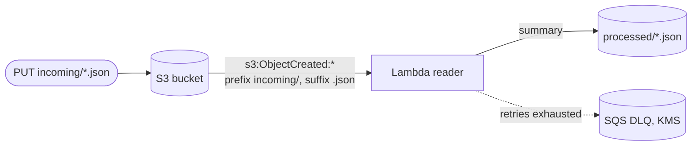

# Lambda triggered by S3

A JSON file dropped under `incoming/` invokes a Lambda function (Python 3.13, arm64) through an S3 notification. The
function writes a summary of the file under `processed/`. The invocation is asynchronous: it is retried twice on error,
then the failure goes to an SQS dead letter queue.

---

## Architecture



- The bucket, the DLQ and the log group are encrypted with the shared KMS key of [base](../base/README.md).
- The function has no VPC: it only calls S3 and SQS.
- The function writes into the bucket that triggers it. The notification filters `incoming/`, **and** the code ignores
  any other key (recursion guard): never rely on the filter alone.
- Objects expire after 7 days (lifecycle rule).

## Retry & failure handling

| Mechanism | Values | Where a failure lands |
|---|---|---|
| Asynchronous invocation retries (S3 invokes the function asynchronously) | `maximum_retry_attempts = 2` (3 calls in all), `maximum_event_age_in_seconds = 3600`; on AWS the retries wait 1 then 2 minutes | After the last retry, or after one hour: the failure record goes to the DLQ `lab-lambda-s3-dlq` |
| Invalid JSON | The function raises `ValueError`: an error like any other, so retried and dead-lettered | DLQ |
| Key outside `incoming/` | Ignored and logged: not an error | Nowhere |
| DLQ | Messages kept 14 days (the maximum), encrypted with the shared key | The message is the invocation record: `requestPayload` (the S3 event), `requestContext.condition = RetriesExhausted`, `approximateInvokeCount`, and the error |

The summary is written under a key derived from the source key: a retry overwrites it, so the processing is idempotent.

## Quick Start

The sample reads the shared KMS key from the state of `base`: apply `base` first.

```bash
# Initialize (needs TF_VAR_state_bucket in the root .env) and apply, from the repository root
task lambda-s3:init
task lambda-s3:apply
```

## Try it

```bash
BUCKET="$(terraform -chdir=samples/lambda-s3/infra output -raw bucket_name)"
DLQ="$(terraform -chdir=samples/lambda-s3/infra output -raw dlq_url)"

# A valid file: its summary appears under processed/
echo '{"id":"demo","items":[1,2,3]}' | aws s3 cp - "s3://$BUCKET/incoming/demo.json"
aws s3 cp "s3://$BUCKET/processed/demo.json" -

# A file that is not JSON: after the retries, the failure record lands in the DLQ
echo 'not-json' | aws s3 cp - "s3://$BUCKET/incoming/poison.json"
aws sqs receive-message --queue-url "$DLQ" --wait-time-seconds 20
```

## Tests

```bash
# Offline: ruff, pyright and pytest on the function, from the repository root
task lambda-s3:app-test

# terraform test on a throwaway Floci container (fake credentials, no AWS account)
task lambda-s3:test

# Smoke test on the real account of AWS_PROFILE, after `apply` (asks for confirmation, for you only)
task lambda-s3:e2e
```

`task lambda-s3:test` applies the stack on the emulator, then runs an end-to-end check (`infra/tests/e2e`): it drops a
valid and a poisoned file, waits for the summary and for the failure record in the DLQ (3 invocations), and reads the
contract back from the emulator. The asynchronous retries run back to back on Floci (`tf-floci-test`). Floci does not
enforce IAM: the policies, including the KMS actions, follow the AWS documentation and are only exercised by
`task lambda-s3:e2e`. CI runs the Python checks and the Terraform test on every pull request (`build-lambda-s3`).

## Cost

Nothing is billed at rest by this stack (S3, Lambda, SQS, CloudWatch Logs with one day of retention): you pay per
request, within the free tiers for a lab. The shared key and the endpoints come from [base](../base/README.md).

## Task commands

| Command | Description |
|---|---|
| `task lambda-s3:init` | Initialize Terraform with the shared S3 state bucket |
| `task lambda-s3:plan` | Plan the changes |
| `task lambda-s3:apply` | Apply the changes |
| `task lambda-s3:destroy` | Destroy the resources |
| `task lambda-s3:test` | `terraform test` on Floci, e2e checks included |
| `task lambda-s3:app-test` | ruff, pyright and pytest on the Python code |
| `task lambda-s3:e2e` | Smoke test on the real account (you only) |
| `task lambda-s3:docs` | Regenerate the Terraform documentation |

---

Terraform reference (inputs, outputs, resources): [`infra/TFDOCS.md`](infra/TFDOCS.md), generated by pre-commit.
