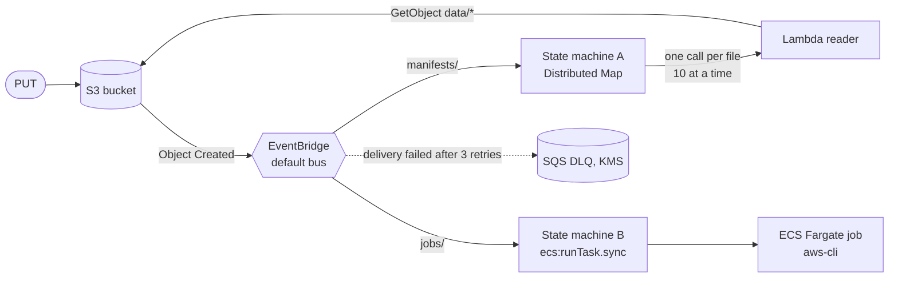

# Step Functions triggered by S3

Two Step Functions state machines started by files dropped in one S3 bucket, through EventBridge rules:

- **(A) Lambda map**: a manifest dropped under `manifests/` lists files; a Distributed Map state reads them in
  parallel, one Lambda invocation per file.
- **(B) ECS job**: a file dropped under `jobs/` starts an ECS Fargate job; the state machine waits for it and retries it.

---

## Architecture



- A manifest is a JSON array: `[{"key": "data/a.json"}, {"key": "data/b.json"}]`. The listed files must be JSON files under
  `data/`: that is all the reader function may read.
- The job copies `s3://<bucket>/<key>` of the file and **fails when it is empty** (that is the business failure of the
  tests). It runs in the private subnets, through the endpoints of [base](../base/README.md).
- The bucket, the DLQ and the log groups are encrypted with the shared KMS key of [base](../base/README.md). The
  state machines log errors only, without the execution data.

## Retry & failure handling

| Mechanism | Values | Where a failure lands |
|---|---|---|
| EventBridge target, delivery of the event to the state machine | `maximum_retry_attempts = 3`, `maximum_event_age_in_seconds = 3600` on both rules | After the retries: the event goes to the DLQ `lab-step-function-s3-events-dlq` (kept 14 days) |
| (A) transient Lambda errors | `Retry` on `Lambda.ServiceException`, `AWSLambdaException`, `SdkClientException`, `TooManyRequestsException`: 3 attempts, from 1 s, backoff 2, full jitter | The Map run fails |
| (A) file not there yet | The function raises `ObjectNotReadyError`; `Retry`: 3 attempts, from 2 s, backoff 2 (the file may arrive after the manifest) | The Map run fails |
| (A) invalid JSON file | `ValueError`: not retried | The Map run fails |
| (A) a failed file | `ToleratedFailurePercentage = 0`: one failed file fails the whole Map run | Execution `FAILED` (`States.ExceedToleratedFailureThreshold`) |
| (B) job | `Retry` on `States.TaskFailed` (the container exits with an error): 2 retries, from 10 s, backoff 2, full jitter; `TimeoutSeconds = 900` | Execution `FAILED` after 3 attempts |

What happens to a failed execution (`FAILED`) is up to you: look at the executions in the console or with
`aws stepfunctions list-executions --status-filter FAILED`. This sample has no alarm.

## Quick Start

The job image comes from the ECR Public pull through cache of `base`: **warm it up once before the first apply** (see
[base](../base/README.md#container-images-ecr-pull-through-cache), the aws-cli line). The job runs on ARM64 by default
(`job_cpu_architecture`, the cheapest on Fargate): pull the `linux/arm64` image, or set `X86_64` for the other platform.

```bash
# Initialize (needs TF_VAR_state_bucket in the root .env) and apply, from the repository root
task step-function-s3:init
task step-function-s3:apply
```

## Try it

```bash
BUCKET="$(terraform -chdir=samples/step-function-s3/infra output -raw bucket_name)"

# (A) two files, then the manifest that lists them
echo '{"id":"a","items":[1,2,3]}' | aws s3 cp - "s3://$BUCKET/data/a.json"
echo '{"id":"b"}' | aws s3 cp - "s3://$BUCKET/data/b.json"
echo '[{"key":"data/a.json"},{"key":"data/b.json"}]' | aws s3 cp - "s3://$BUCKET/manifests/demo.json"

# (B) a file the job can read
echo 'hello' | aws s3 cp - "s3://$BUCKET/jobs/demo.txt"

aws stepfunctions list-executions --state-machine-arn "$(terraform -chdir=samples/step-function-s3/infra output -raw lambda_map_state_machine_arn)"
aws stepfunctions list-executions --state-machine-arn "$(terraform -chdir=samples/step-function-s3/infra output -raw ecs_job_state_machine_arn)"
```

## Tests

```bash
# Offline: ruff, pyright and pytest on the function, from the repository root
task step-function-s3:app-test

# terraform test on a throwaway Floci container (fake credentials, no AWS account)
task step-function-s3:test

# Smoke test on the real account of AWS_PROFILE, after `apply` (asks for confirmation, for you only)
task step-function-s3:e2e
```

`task step-function-s3:test` applies the stack on the emulator, then runs an end-to-end check (`infra/tests/e2e`): it drops a
valid manifest and a manifest that lists a missing file, a readable and an empty job file, waits for the four
executions, counts the 3 submissions of the failing task, and reads the contract (definitions, rules, DLQ, encryption)
back from the emulator. On Floci the retry delays are capped at 30 seconds, and the test uses the public image on
`X86_64`: Floci runs a task for the architecture it names, which would need emulation on an amd64 runner for `ARM64`.
The DLQ path of the rules is not reproducible there (it needs a delivery that fails). Floci does not enforce IAM: the
policies, including the KMS actions and the key policy statement of EventBridge in `base`, follow the AWS
documentation and are only exercised by `task step-function-s3:e2e`. CI runs the Python checks and the Terraform test on every pull
request (`build-step-function-s3`).

## Cost

Nothing is billed at rest by this stack: Lambda, Step Functions (per state transition), Fargate (per second of task),
S3, SQS and CloudWatch Logs (one day of retention) are billed per use. The ECS job reaches AWS through the interface
endpoints of [base](../base/README.md), which are billed there.

## Task commands

| Command | Description |
|---|---|
| `task step-function-s3:init` | Initialize Terraform with the shared S3 state bucket |
| `task step-function-s3:plan` | Plan the changes |
| `task step-function-s3:apply` | Apply the changes |
| `task step-function-s3:destroy` | Destroy the resources |
| `task step-function-s3:test` | `terraform test` on Floci, e2e checks included |
| `task step-function-s3:app-test` | ruff, pyright and pytest on the Python code |
| `task step-function-s3:e2e` | Smoke test on the real account (you only) |
| `task step-function-s3:docs` | Regenerate the Terraform documentation |

---

Terraform reference (inputs, outputs, resources): [`infra/TFDOCS.md`](infra/TFDOCS.md), generated by pre-commit.
